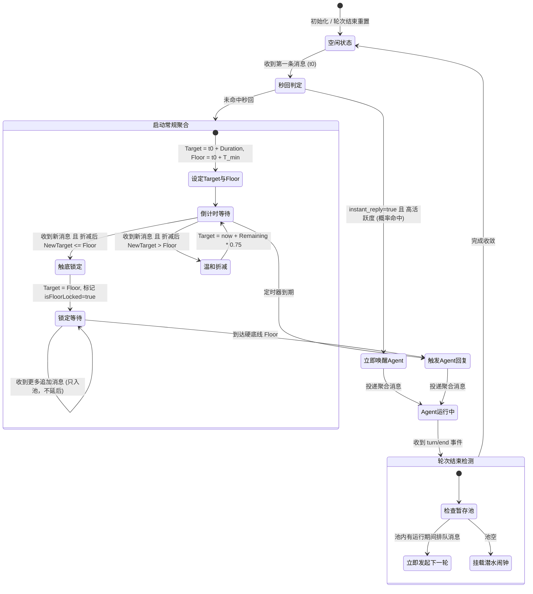

# 系统架构与设计哲学

本文档深入阐述 **kujira** 的模块构成、生命周期装配、数据流转机制、仿生动态时钟数学模型与底层存储设计哲学。

---

## 1. 架构总览

kujira 作为 DeepSeek Harness (DSH) 的 Cordis 插件运行，在腾讯 QQ 开放平台官方 Bot API v2 与 DSH 核心运行时之间构建起生产级、合规、拟人化的双向代理通道。

与旧版基于 OneBot 11 逆向协议端的架构截然不同，kujira **完全废除了对 NapCat / SnowLuma 等外部协议端的依赖**，直接通过正向 WebSocket 长连接接入官方网关，并通过 OpenAPI 规范完成富媒体与消息的主动交互。

```
+-----------------------------------------------------------------------------------------+
|                                 DeepSeek Harness (DSH)                                  |
|  [Agent Engine] <---> [Session Service] <---> [kujira-session 专属预设 (工具/Prompt)]   |
+-----------------------------------------------------------------------------------------+
                                             ^
                                             | (Cordis Lifecycle / Events / Tool Calls)
                                             v
+-----------------------------------------------------------------------------------------+
|                                         kujira                                          |
|                                                                                         |
|  +--------------------+  +----------------------+  +------------------+  +-----------+  |
|  |   SessionManager   |  | OutboundStreamBridge |  | MemoryService    |  | FaceStore |  |
|  | (Peer 状态机/映射) |  | (静默拦截/出站驱动)  |  | (双层画像/顺手提炼)| | (表情管理)|  |
|  +--------------------+  +----------------------+  +------------------+  +-----------+  |
|  |   SystemEventHub   |  |   ProactiveManager   |  |  SlangDatabase   |  | Scheduler |  |
|  | (统一系统事件中枢) |  | (事件驱动仿生时序引擎)| | (黑话学习与索引) |  | (定时任务)|  |
|  +--------------------+  +----------------------+  +------------------+  +-----------+  |
|                                             ^                                           |
|                                             | (send_qq_message / send_file / 串行队列)  |
|                                             v                                           |
|  +-----------------------------------------------------------------------------------+  |
|  |                                PerPeerSerialSender                                 |  |
|  |                              (单对端出站串行化发送队列)                             |  |
|  |                                + InboundReplySlots                                |  |
|  |                     (入站锚点与单调槽位管理，防 40054005 与 50015001)                     |  |
|  +-----------------------------------------------------------------------------------+  |
|                                             ^                                           |
|                                             | (OpenAPI / WebSocket Gateway v2)          |
|                                             v                                           |
|  +-----------------------------------------------------------------------------------+  |
|  |                                KujiraGatewayClient                                 |  |
|  |                      (官方正向 WebSocket 网关客户端 + 凭据鉴权)                    |  |
|  +-----------------------------------------------------------------------------------+  |
+-----------------------------------------------------------------------------------------+
                                             ^
                                             | 官方 Bot API v2 (WebSocket + OpenAPI)
                                             v
+-----------------------------------------------------------------------------------------+
|                               腾讯 QQ 开放平台 (C2C 单聊)                               |
+-----------------------------------------------------------------------------------------+
```

---

## 2. 插件生命周期与装配管线

插件主入口位于 `src/index.ts`，导出符合 Cordis 标准的插件定义：

- `name`: 插件唯一标识 `kujira`；
- `inject`: 声明核心依赖服务，包含 `tools`、`systemPrompt`、`agents`、`session` 及可选的 `settings`；
- `apply(ctx, config)`: 插件装配函数，按严格拓扑顺序执行初始化：

1. **凭据与配置装配**：
   - 接入 DSH 官方 `ctx.credentials`，安全加载 `appId` 与 `appSecret`（支持从环境变量 `QQ_BOT_APP_ID` / `QQ_BOT_SECRET` 或 `$DSH_HOME/.credentials.yaml` 读取）；
   - 合并 28 项核心配置（含管理员名单、隐私工具热隔离与冷场搭话黑白名单），挂载过时配置物理自愈过滤器（全自动剥离历史废弃字段）。
2. **底层存储就绪**：
   - 初始化 SQLite 数据库（`MessageDatabase`，管理消息记录、`peer_openid_map` 映射、黑话词库与被动回复锚点）；
   - 初始化媒体存储管理器（`MediaStorageManager`），挂载外来图片/语音的 TTL 定时清理机制。
3. **网关与时序引擎启动**：
   - 实例化 `KujiraGatewayClient`，启动正向 WebSocket 客户端并自动建立心跳保活；
   - 启动基于 Peer 独立的事件驱动仿生时钟管理器（`ProactiveManager`），接管单聊聚合与冷场唤醒。
4. **单聊专属预设装配（SSOT）**：
   - 通过单一真相源 (`src/constants/preset.ts`) 动态向 `agentPresets` 注册 `kujira-session` 预设；
   - 专属预设配置 `complete: true`，彻底屏蔽 DSH 繁重的 Coding 提示词，注入 QQ 单聊拟人化专属 Prompt；
   - 工具集隔离：预设挂载 `kujira/tools`（包含 16 大单聊专属工具），**绝不向 WebUI 常规会话泄露**；同时在会话作用域支持基于 `agent.ctx.tools.restrict({ deny })` 的可逆隐私工具组热隔离，配置保存经 `reconcile` 即可对存活会话实时施加或解除限制。
5. **出站桥接与串行下发**：
   - 启动出方向事件流拦截器（`OutboundStreamBridge`）与单对端串行发送器（`PerPeerSerialSender`）；
   - 挂载 `InboundReplySlots`，维护持久化入站锚点与单调递增 `msg_seq` 槽位，彻底杜绝 `40054005` 跨天去重拒绝，保障流式接口规避无锚点 `50015001` 异常，并在锚点失效时平滑降级普通主动消息。
6. **WebUI 设置卡片与 REST 路由**：
   - 注册 `/plugins/kujira/config`、`/plugins/kujira/peers` 等 REST 路由，全面接入宿主 `connection` 服务鉴权（Fail-Closed 策略）；
   - 凭据提交执行只写保护，禁止明文回显；已互动用户接口仅返回脱敏短 OpenID 与最近消息摘要；支持 28 项核心配置项 volatile 动态热更新。

---

## 3. 入站消息处理流

```
QQ 官方 WebSocket 网关推送 C2C_MESSAGE_CREATE
    │
    ▼
KujiraGatewayClient 接收并解构官方 Payload
    │
    ├─► 若为 Heartbeat / Ready / Resumed 事件: 维护连接心跳与 Session ID 恢复
    │
    └─► 若为 C2C 单聊消息事件:
            │
            ├─► 消息持久化写入 SQLite (MessageDatabase)
            │
            ├─► 解析并维护 peer 与 32 位大写十六进制 openid 映射
            │
            ├─► 入站多媒体裸 GET 流式即时落盘:
            │       ├─ 图片附件: 流式落盘至 files/<peer>/，计算 MD5 去重，渲染 [图片:本地路径]
            │       ├─ 语音附件: 优先裸 GET voice_wav_url，落盘 .wav 并提取 asr_refer_text
            │       └─ 常规文件: 安全文件名净化防路径穿越 (../ 约束)，落盘本地直链
            │
            ├─► 合并转发与结构化引用解构:
            │       ├─ message_type=102: 解构合并转发卡片为结构化聊天记录
            │       └─ message_type=103: 提取 ref_msg_idx，匹配对应短 ID (msg_<n>)
            │
            ├─► 检查是否被 wait_for_user_messages 挂起收集器捕获:
            │       └─ 若命中: 将消息收集入暂存池，直接返回并延长收集超时
            │
            ├─► 斜杠命令路由判定 (isSlashCommand):
            │       └─ 若命中: 分发至 10 大指令处理器，执行完毕直接回发结果，终止 Agent 轮次
            │
            └─► 移交仿生时序引擎 (ProactiveManager):
                    └─ 进入事件驱动聚合状态机 (计算动量、温和折减或秒回)
```

---

## 4. 事件驱动单聊消息聚合与仿生动态时钟

### 4.1 为什么废除固定周期轮询？
在旧版实现中，主动回复与聚合多依赖全局定时器（如固定每 3 分钟轮询一次）。这种机制存在两大严重缺陷：
1. **机械感极强**：用户发信时刻恰逢 tick 倒计时前或刚 tick 完，导致响应延迟在 0~180 秒之间剧烈抖动，无法形成稳定的聊天预期；
2. **多用户饥饿与并发混乱**：全局时钟无法感知特定对端的连续发信节奏，用户刚发了一句话正在打字，机器人突然强行插话；或者用户连续发了 5 条，机器人迟迟毫无反应。

kujira 彻底重构为：**基于 Peer 独立的事件驱动时序器 + 仿生随机区间 + 动态动量折减与下限锁定机制**。

### 4.2 双层活跃度度量体系 (Activity & Momentum)

时序引擎在决定回复节奏前，首先度量当前会话的活跃度指数 $\text{Score}_{act} \in [0, 1]$：

#### 1. 微观响应时效 ($\Delta t_{turn}$)
衡量用户是否正在手机前注视屏幕：
$$\Delta t_{turn} = t_{in} - t_{bot\_out}$$
- $\Delta t_{turn} \le 15\text{s}$：极速接话，处于高强度交互状态；
- $15\text{s} < \Delta t_{turn} \le 120\text{s}$：正常连贯聊天；
- $\Delta t_{turn} > 120\text{s}$：摸鱼、切屏或异步对话。

#### 2. 宏观历史动量 (Past $X$ Completed Turns)
不看僵化的自然时间窗口（避免冷场片刻误判为绝对冷淡），而是纯函数回溯 SQLite 中**最近 $X$ 轮（默认 3~5 轮）已完成的交互**：
- 提取每轮用户从 Bot 回复到再次发话的时延；
- 提取每轮用户发信的消息密度（单轮连发多条 vs 单发）；
- 结合微观与宏观因子加权计算得出综合活跃度 $\text{Score}_{act}$。

### 4.3 偏置系数与随机采样公式

设当前聚合配置区间为 $[T_{min}, T_{max}]$，随机数 $r \sim U(0, 1)$：
- 根据 `proactive_attitude`（互动偏好）映射偏置幂次 $p$：
  - **热情 (`enthusiastic`)**：$p = 2.0$（采样偏向 $T_{min}$，反应迅捷）；
  - **均衡 (`balanced`)**：$p = 1.0$（均匀分布）；
  - **冷淡 (`aloof`)**：$p = 0.5$（采样偏向 $T_{max}$，留白充足、节奏沉着）。
- 随机采样公式：
  $$\text{Duration} = T_{min} + (T_{max} - T_{min}) \cdot r^p$$

### 4.4 聚合状态机与防饥饿模型

每个 Peer 维护独立的状态机控制：



> **核心价值**：一旦连续追加的消息将倒计时压缩到底限 $\text{FloorTime}$，之后用户连发再多消息**也不会把时间继续往后拖延**。到点立刻打断投递，彻底消除打字饥饿感，自然形成拟人的半截插话节奏。

---

## 5. 用户侧静默出站体系

### 5.1 思考与出站物理隔离
在大模型执行任务时，常规的文字流可能夹带推演、工具规划甚至调试信息。kujira 严格遵循**「用户侧静默原则」**：
- 废除纯文本的默认推流；
- 只有大模型显式调用 **`send_qq_message`** 工具时，内容才会被投递至出站通道；
- 模型的直接文本输出被视为内部日志记录，不会向 QQ 用户下发。

### 5.2 单 Agent 顺手提炼
旧版系统常采用“独立后台回顾 Agent”对历史进行反思和提取，这造成了双倍的 Token 开销与并发状态锁竞争。kujira 采用**单 Agent 顺手提炼模式**：
- 模型的 Tool Call 并不终结当前回合；
- 模型在调用 `send_qq_message` 完成对用户的回复后，可在同一轮次中顺手调用 `create_memory`、`record_slang` 或 `collect_face`；
- 在全部工具调用完毕后，模型输出 `[已回复]` 优雅结束内部回合，兼顾极高的执行效率与记忆持久化。

### 5.3 消息引用（reply_to）短 ID 规范
- 平台真实入站消息 ID 较长且包含多种符号，直接暴露容易诱发模型幻觉；
- 插件在上下文注入阶段统一将消息映射为短 ID（如用户消息为 `msg_1`、`msg_2`，机器人自身历史消息为 `msg_self_1`）；
- 模型需要明确引用某条具体消息时，只需在 `send_qq_message` 中传入 `reply_to: "msg_1"`，出站桥将自动解析为底层真实的 `message_reference` 锚点。

---

## 6. 单聊强隔离与底层存储设计

### 6.1 SQLite 数据库索引设计
kujira 在本地采用嵌入式 SQLite（`better-sqlite3`）维护单聊核心状态表：
- `messages`：记录入站/出站消息时间戳、短 ID、真实 ID、媒体路径与内容摘要；
- `peer_openid_map`：维护 QQ 官方 32 位大写十六进制 `openid` 与内部对端 `peer` 的双向索引；
- `inbound_reply_slots`：入站回复槽位跟踪表。记录每个入站 `msg_id` 的 `last_seq` 消费进度与失效标记，为跨轮次回复提供防 `40054005` 幂等去重保障与出站/入站 ID 强隔离；
- `slang_terms`：黑话知识库条目表（记录触发情境、招牌例句与使用计数）。

### 6.2 Markdown 双层记忆与字符预算硬拒绝
记忆分为两个独立层级，均采用纯 Markdown 存储于 `.dsh/kujira/memory/`：
1. **用户画像 (`user_<openid>.md`)**：记录用户的性格特征、稳定偏好、习惯约定；
2. **会话规则 (`session_<peer>.md`)**：记录当前单聊的短期业务上下文与约定规则。

**字符预算硬拒绝机制**：
为防止大模型无限追加记忆导致上下文被撑爆，写入侧由 `user_profile_budget_chars`（默认 2200 字符）与 `session_memory_budget_chars`（默认 2200 字符）严格门控。一旦超出预算，工具执行直接报错并要求模型必须先精简旧内容再行写入。
